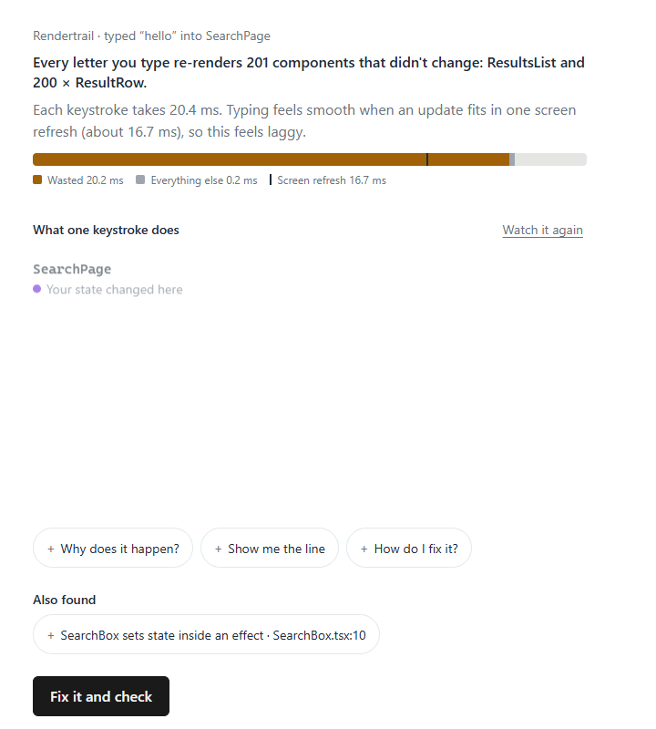

# Rendertrail

Rendertrail shows you **why** a React component is slow, in plain words, right inside Claude. Claude
sends it a few component files and a short interaction (like typing into a search box); Rendertrail
records every render in headless Chrome on your computer and answers with the main problem, what it
costs and the exact line to change, then re-runs the same interaction to prove the fix worked.



It's an [MCP App](https://github.com/modelcontextprotocol/ext-apps): one tool, `inspect_render`,
plus a card that Claude Desktop shows inline in the chat. Claude Code gets the same answer as text.

## Install

You need **Node.js 22 or later** and **Google Chrome** (or Chromium, see [Requirements](#requirements)).

### Claude Desktop: the bundle (one click)

1. Download `rendertrail.mcpb` from the [latest release](https://github.com/cfl777/rendertrail/releases/latest).
2. Double-click it, or open Claude Desktop → **Settings → Extensions** and drag the file in.
3. Click **Install**. Start a new chat.

### Claude Desktop: the config file

Open Claude Desktop → **Settings → Developer → Edit Config** and add Rendertrail to
`claude_desktop_config.json`, then restart Claude Desktop:

```json
{
  "mcpServers": {
    "rendertrail": {
      "command": "npx",
      "args": ["-y", "rendertrail"]
    }
  }
}
```

### Claude Code

```sh
claude mcp add rendertrail -- npx -y rendertrail
```

Claude Code doesn't show the card; the text answer stands on its own.

## Try it

[`examples/laggy-search`](examples/laggy-search) is a small app with a search box that feels laggy.
Open that folder in Claude and ask:

> Why is typing in the search box laggy?

You get: *Every letter you type re-renders 200 rows that didn't change*, about 20 ms per letter
(more than one screen refresh, so it feels laggy), because `filters` is a new object on every render
at `SearchPage.tsx:19`. Press **Fix it and check**: Claude wraps it in `useMemo`, records the same
typing again, and the card says *Fixed. Each keystroke now takes 0.1 ms.*

On your own code, ask the same kind of question about a component that feels slow. Claude picks the
files and the interaction; you don't need to write a test.

## What it reports

Two problems for now, ranked by what they cost:

- **A prop that breaks `memo`.** A `memo` component re-renders although nothing it shows changed,
  because a prop (an object, array or function) is created anew on every render. Rendertrail shows
  how much time that wastes per keystroke or click, which components re-rendered for nothing, and
  the line that creates the prop. The fix is `useMemo` or `useCallback`.
- **State set inside an effect.** A component copies a value into state inside `useEffect`, so
  React renders it twice where once would do. The fix is to compute the value during render.

Every number comes from a real recording, measured in code. Rendertrail never calls an AI model:
your own Claude explains the findings and writes the fix.

## Privacy

- **Everything runs on your computer.** Rendertrail records your code locally and sends nothing
  anywhere: it has no network code of its own besides the optional localhost `--http` server.
- **The recorded page has no network access.** Every request it makes is blocked, so the component
  can't load or send anything.
- **Runs are stored locally**, in `~/.rendertrail/runs` (the last 50), so a re-run can be compared
  with an earlier one. Delete the folder whenever you like. `RENDERTRAIL_RUNS_DIR` (an absolute
  path) stores them elsewhere.
- **Anonymous counts are off unless you turn them on**, and even then they are only stored, never
  sent: sending is not implemented. When on, each run adds to three counters for the current week in
  `~/.rendertrail/counts.json`: the number of runs, the number of findings per rule, and the number
  of fixes checked (re-runs where the main problem went away). The week (like `2026-W46`) is the only
  time information. No code, file names, component names, paths, run ids or machine id are counted.
  - Turn on: set `RENDERTRAIL_TELEMETRY=1` in the server's environment, or create
    `~/.rendertrail/config.json` containing `{ "telemetry": true }`.
  - Turn off: remove that, or set `RENDERTRAIL_TELEMETRY=0`. `DO_NOT_TRACK=1` always turns them off.
  - Check: `npx rendertrail --telemetry-status` says whether they're on and prints the counts.

## Requirements

- **Node.js 22 or later.**
- **Google Chrome.** Rendertrail starts your installed Chrome headless, so there's nothing to
  download. Without Chrome it uses Playwright's Chromium, which you install once (about 150 MB);
  the tool's answer tells you the exact command, which looks like
  `npx playwright-core@1.63.0 install chromium`.
- React 18 or 19, function components. Rendertrail records with its own copy of React 19.

## Limits

Not yet supported:

- A full inspector view (the card shows the main problem and up to two more).
- Claude on the web and on mobile: they need a hosted server, and Rendertrail runs locally.
- Checks on pull requests.
- Recording a whole app: Claude passes the files needed for one component, and imports it didn't
  send are replaced with stand-ins (the answer lists them).
- Rules for class components (they're still recorded).
- Other frameworks than React.
- React Compiler mode.

## Command line

```sh
npx rendertrail                     # the MCP server over stdio (what Claude starts)
npx rendertrail --http              # the MCP server over HTTP on http://127.0.0.1:3001/mcp (PORT overrides)
npx rendertrail --telemetry-status  # are the anonymous counts on, and what they hold
npx rendertrail --version
npx rendertrail --help
```

## Development

Needs Node 22 or later.

```sh
npm install
npm run build          # card -> dist/card.html, server -> dist/server.js, dist/instrument.js
npm test               # unit tests
npm run test:golden    # builds, then golden tests: records fixtures/ in your installed Chrome
node dist/server.js    # the MCP server over stdio
npm run start:http     # the MCP server over HTTP, for the ext-apps basic-host
npm run dev:card       # the card in every state, no host needed: http://127.0.0.1:5177/
npm run bundle         # builds, then the MCP Bundle: dist/rendertrail.mcpb
npm run demo:gif       # docs/demo.gif from the card harness
npm pack               # builds, then the npm tarball
```

Each run is stored in `~/.rendertrail/runs` (the last 50 are kept), so a later call can compare
against it with `baselineRunId`. Set `RENDERTRAIL_RUNS_DIR` to an absolute path to store them elsewhere.
`RT_SAVE_TRACES=1 npm run test:golden` rewrites the recorded traces the analyzer's unit tests use.

Build the release bundle on macOS or Linux: it carries esbuild's binaries for macOS and Windows,
and a bundle built on Windows can't mark the macOS ones as executable.

Connect a checkout to Claude Code with `claude mcp add rendertrail -- node <absolute path>/dist/server.js`,
or to Claude Desktop with an `mcpServers` entry that runs `node <absolute path>/dist/server.js`.

`HANDOFF.md` has the scope, the decisions and the plan; `CLAUDE.md` has the rules for coding sessions.

## License

MIT
